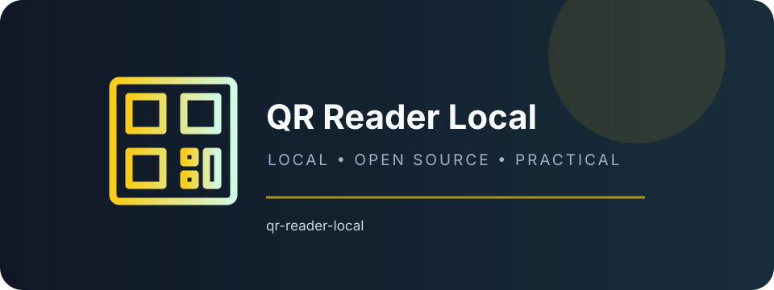

<p align="center"></p>
<p align="center"></p>
<p align="center">   </p>
<p align="center"></p>

## 🧭 Overview
QR Reader Local decodes QR codes from image files using a browser canvas and the jsQR library. Image pixels are processed in the browser; the app has no upload endpoint or analytics.

## ✨ Features
- 📷 Reads QR codes from PNG, JPEG, and other browser-supported images.
- 🔍 Shows decoded text and the detected QR format.
- 📋 Copies the decoded value with one click.
- 🔒 Processes the image locally in your browser.

## 🎬 Demo
```text
Choose an image containing a QR code → the decoded text appears below the preview.
No camera access or account is required.
```
This is a local example; files are processed in your browser or on your machine.

## 🚀 Quick Start
```bash
npm install
npm start
```
Open the Vite address printed in the terminal. Use a clear, well-lit image for best results.

## 🧰 Tech Stack
- Node.js 18+
- Vite
- jsQR
- Browser File API and Canvas

## 🗂️ Folder Structure
```text
index.html
src/main.js
src/qr-utils.js
src/styles.css
tests/qr-utils.test.js
package.json
assets/overview.svg
```

## 🗺️ Roadmap
- [x] Core workflow
- [x] Local-first processing
- [ ] More format and edge-case coverage
- [ ] Optional CI examples

## 🤝 Contributing
Issues and focused pull requests are welcome. Add regression tests for bug fixes and document new behavior.

## 📄 License
Released under the [MIT License](LICENSE).

<p align="center"></p>
